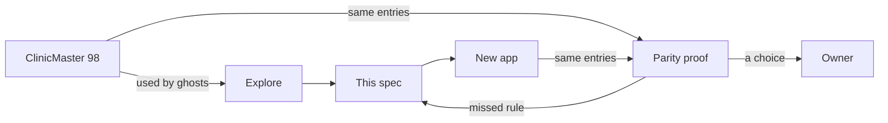

# Design Document

## Overview

ClinicMaster Reborn is a modern app with the same screens and the same checks as ClinicMaster 98. The checks are data, not code: one ordered list of rules per screen, taken from this spec. When proof testing finds a rule that was missed, it is added to the list and the app follows it at once.

## Architecture

## Data Models

### Clients

| Column | Kind | Required | Notes |
| --- | --- | --- | --- |
| Name | text | yes |  |
| HP | digits | yes |  |
| DOB | date | no |  |
| Pet | text | no |  |
| Breed | text | no |  |
| Remarks | text | no |  |

### Appointments

| Column | Kind | Required | Notes |
| --- | --- | --- | --- |
| Date | date | yes |  |
| Time | select | yes | 09:00, 10:00, 11:00, 12:00, 14:00, 15:00, 16:00, 17:00 |
| Client | select | yes | one of Clients → Name |

### Invoices

| Column | Kind | Required | Notes |
| --- | --- | --- | --- |
| Client | select | yes | one of Clients → Name |
| Service | select | yes | Bath $45.00, Full groom $85.50, Deshed $69.95, Nail trim $15.25 |
| Subtotal | money | - | worked out, see Money |
| GST | money | - | worked out, see Money |
| Total | money | - | worked out, see Money |

## Checks

Checked in this order. The first one that fails is the only one reported.

| Screen | Code | Check | Message | Found by |
| --- | --- | --- | --- | --- |
| Clients | 101 | required Name | Name is required. | exploring |
| Clients | 102 | required HP | HP must be 8 digits starting with 8 or 9. | exploring |
| Clients | 102 | digits HP | HP must be 8 digits starting with 8 or 9. | exploring |
| Clients | 103 | date DOB | DOB must be DD/MM/YYYY. | exploring |
| Clients | 104 | unique HP | HP already on file. | exploring |
| Clients | 105 | maxLength Name > 30 | Name is too long (30 letters at most). | random testing |
| Appointments | 201 | required Client | Choose a client, date and time. | exploring |
| Appointments | 201 | required Date | Choose a client, date and time. | exploring |
| Appointments | 201 | required Time | Choose a client, date and time. | exploring |
| Appointments | 202 | date Date | Date must be DD/MM/YYYY. | exploring |
| Appointments | 210 | closed Date | Closed on Sundays. | exploring |
| Appointments | 211 | unique Date + Time | Slot already taken. | exploring |
| Invoices | 301 | required Client | Choose a client and a service. | exploring |
| Invoices | 301 | required Service | Choose a client and a service. | exploring |

## Money

Subtotal is the price of the Service. GST is 9% of it. Total is the sum.

ClinicMaster 98 rounds tax **down**:

- Bath: 45.00 × 9% = 4.0500, app shows 4.05
- Full groom: 85.50 × 9% = 7.6950, app shows 7.69
- Deshed: 69.95 × 9% = 6.2955, app shows 6.29
- Nail trim: 15.25 × 9% = 1.3725, app shows 1.37

The owner chose to round to the nearest cent. This is the one intended difference from the old app.

## Correctness Properties

1. **Same answer.** For any entry on any screen, the new app gives the same error code as ClinicMaster 98, or both save the same row.
2. **First problem only.** For any entry that breaks several checks, the reported code is the lowest one that fails.
3. **Sums add up.** For any invoice, Total = Subtotal + GST.
4. **Nothing lost moving in.** Every row read from ClinicMaster 98 appears unchanged in the new app.

## Testing Strategy

Property-based parity testing: generate random entries (names of any length, numbers of any shape, dates in any format, any slot), make each one in both apps, and compare the answers. Every rule above is also tested from both sides on purpose.
